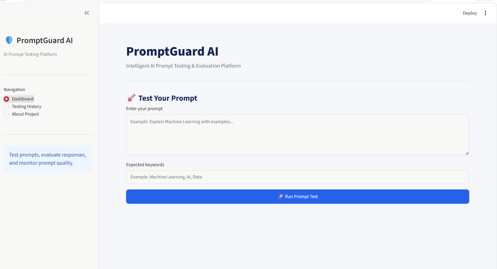
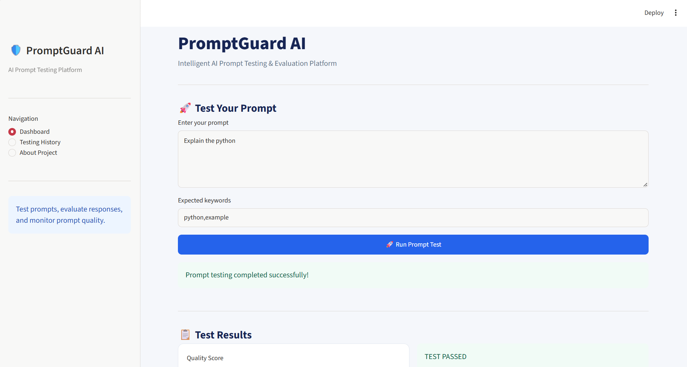
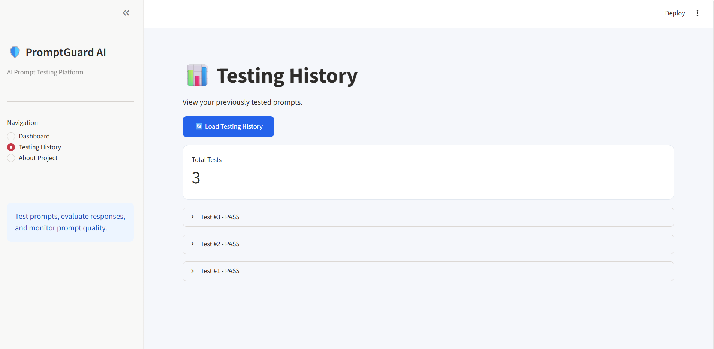

# 🛡️ PromptGuard AI

### Intelligent AI Prompt Testing & Evaluation Platform

PromptGuard AI is a Python-based application designed to improve user prompts, generate responses, evaluate response quality and maintain testing history.

## Features

- Prompt validation
- Automatic prompt improvement
- Local demo response generation
- Response quality evaluation
- Keyword matching
- PASS/FAIL testing status
- SQLite testing history
- Interactive Streamlit interface
- FastAPI backend
- Automated testing using Pytest

## Technologies Used

- Python
- FastAPI
- Streamlit
- SQLite
- Pytest
- Requests

## Project Structure

```text
PromptGuard_AI/
│
├── backend/
│   ├── main.py
│   ├── prompt_engine.py
│   ├── evaluator.py
│   └── database.py
│
├── frontend/
│   └── app.py
│
├── tests/
│   ├── test_prompts.py
│   └── test_evaluator.py
│
├── reports/
├── requirements.txt
├── README.md
└── .gitignore
```

## Installation

Clone the repository:

```bash
git clone YOUR_GITHUB_REPOSITORY_URL
```

Move into the project directory:

```bash
cd PromptGuard_AI
```

Create a virtual environment:

```bash
python -m venv venv
```

Activate it on Windows:

```powershell
.\venv\Scripts\Activate.ps1
```

Install dependencies:

```bash
pip install -r requirements.txt
```

## Run the Backend

```bash
python -m uvicorn backend.main:app --host 127.0.0.1 --port 8000
```

Backend documentation:

http://127.0.0.1:8000/docs

## Run the Frontend

Open a second terminal:

```bash
python -m streamlit run frontend/app.py
```

## Run Automated Tests

```bash
python -m pytest tests -v
```

## Evaluation Method

The current evaluation system uses rule-based checks:

- Response length
- Expected keyword matching
- Minimum word count

The system calculates a score out of 100 and assigns PASS or FAIL status.

## Current AI Integration

The current version uses a local demonstration response generator. It does not require an external AI API.

## Future Enhancements

- Optional Gemini API integration
- Semantic response evaluation
- Advanced prompt quality metrics
- Testing reports and analytics
- Cloud deployment

## Author

Shravani Jagdish Rakhade
## 📸 Application Screenshots

### 1. Dashboard


### 2. Prompt Testing Results


### 3. Testing History
